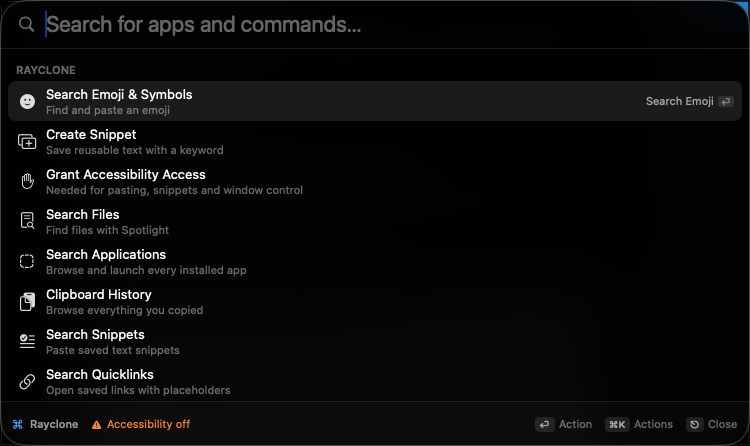

<p align="center">
  
</p>

<h1 align="center">Rayclone</h1>

<p align="center">A native macOS launcher: press <code>⌥Space</code>, find anything, act on it.</p>

<p align="center">
  
</p>

Rayclone is a source-only reimplementation of the Raycast launcher, built from a
reverse-engineering pass over the Raycast bundle installed on this Mac. It has no
Dock icon and no main window — it lives in the menu bar and appears as a floating
panel when you press the hotkey.

**This repository is the distribution.** There are no downloads, releases, or
prebuilt binaries; you clone it, build it locally, and install it at
`~/Applications/Rayclone.app`. The long version of the analysis behind it is in
[`docs/RE-FINDINGS.md`](docs/RE-FINDINGS.md).

## Features

| Area | What it does |
| --- | --- |
| Root search | Fuzzy ranking (prefix > word boundary > consecutive > scattered) blended with time-decayed usage, grouped into sections |
| Applications | Indexes `/Applications`, `Utilities`, `/System/Applications`, the Cryptexes volume and `~/Applications`; launch, reveal, copy path, quit |
| Files | Spotlight-backed search with Quick Look, reveal, open-with, copy path/name, move to trash. Name relevance decides the cut, folders are listed in their own section above files (so a folder and file sharing a name show the folder first) |
| Calculator | Expressions typed directly into the search field: precedence, `^`, `%`, `!`, functions, `0x`/`0b`, and hex/octal/binary rows |
| Clipboard history | Text, image and file captures with dedupe, pin, delete, and paste |
| Snippets | Saved text with a keyword, dynamic placeholders (`{date}`, `{time}`, `{clipboard}`, `{uuid}`), and optional system-wide keyword expansion |
| Emoji | 1,345 bundled entries with keyword search, category order, and recents |
| Quicklinks | URL templates with `{query}` / `{argument}` |
| Web searches | Google, DuckDuckGo, Bing, YouTube, GitHub, Wikipedia, Stack Overflow, Amazon, Maps, X — plus your own |
| Script commands | Your scripts in Raycast's `@raycast.*` metadata format, with an output window |
| Window management | 30 move/resize targets for the focused window via the Accessibility API |
| System actions | Sleep, lock, screensaver, empty trash, hidden files, appearance, volume, media keys, eject disks, quit all |
| Themes | Raycast Dark/Light, Sky, Midnight, Sunset — using the palettes recovered from Raycast's own bundle |

## Requirements

- macOS 14 or later (built and used on macOS 27)
- Xcode Command Line Tools — free, no Apple Developer Program membership
- A full Xcode install if you want the exact toolchain this was developed against
  (the SwiftUI macro plugin does not load from the Command Line Tools alone; the
  build script uses Xcode automatically when it is present)
- Accessibility permission for pasting, snippet expansion and window management

## Install

```bash
# Only if the tools are missing:
xcode-select --install

git clone https://github.com/RavitejaKarra24/rayclone.git
cd rayclone
./install.sh
```

`install.sh` does the whole job in one command:

1. checks that a Swift compiler is available;
2. builds a release binary (using the newer `swiftbuild` engine when the
   toolchain supports it);
3. assembles a real `.app` bundle in `dist/` with `Info.plist`, the icon, and the
   SwiftPM resource bundles in a layout that code signing accepts;
4. ad-hoc signs the nested resource bundles first, then the app, and verifies the
   signature;
5. stops any running copy, then replaces `~/Applications/Rayclone.app`;
6. removes quarantine **only** from that locally built bundle;
7. verifies the installed copy and launches it.

It never uses `sudo` and never changes Gatekeeper policy. Pass `--no-open` to skip
launching.

## First-run permission

Rayclone asks for **Accessibility** the first time it needs to paste into another
app, expand a snippet, or move a window.

- Open **System Settings → Privacy & Security → Accessibility**
- Enable **Rayclone**

Without it the launcher still works: actions copy to the clipboard instead of
pasting, and the footer shows an `Accessibility off` badge you can click to open
the prompt. Nothing leaves your Mac; there is no account, no telemetry, and no
network access in the app.

## Usage

Rayclone is a menu-bar app: look for the ⌘ item in the menu bar, or press the
hotkey. There is no Dock icon by design.

| Key | Action |
| --- | --- |
| `⌥Space` | Open / close the launcher (configurable in Settings) |
| `⌥⇧V` | Clipboard history (configurable) |
| `↑` `↓` | Move the selection |
| `⏎` | Run the primary action, or the highlighted action |
| `⌘K` / `⇥` | Toggle the action panel |
| `⌘1`…`⌘9` | Run the Nth action |
| `⌘,` | Settings |
| `⎋` | Close actions → leave a command view → clear the query → hide |
| `⌘W` | Hide |

Try typing an app name, `2+2*3`, `emoji`, `clipboard`, or a filename.

## Update and uninstall

```bash
# Update from the clone
cd rayclone
git pull --ff-only
./install.sh

# Uninstall
pkill -x Rayclone 2>/dev/null || true
rm -rf "$HOME/Applications/Rayclone.app"
```

Settings and history live in
`~/Library/Application Support/com.rayclone.macos/`; removing that directory
resets the app completely.

## Architecture

```
install.sh                      one-command local install
Scripts/
├── build-app.sh                build + assemble + sign + verify dist/Rayclone.app
├── check.sh                    build with zero warnings + tests + dataset check
├── generate_emoji.py           regenerates the bundled emoji dataset
└── make-icon.swift             renders Icon.icns
Sources/Rayclone/
├── main.swift                  NSApplication bootstrap (agent app, LSUIElement)
├── App/AppDelegate.swift       status item, hotkeys, feature wiring
├── Core/                       theme tokens, fuzzy ranking, frecency, settings,
│                               section order, resource lookup, Carbon hotkeys
├── UI/                         NSPanel launcher, list/action panel, settings,
│                               editors, script output
└── Features/                   one file per capability + the emoji dataset
Tests/RaycloneTests/            expression, ranking, section-order, quicklink tests
docs/RE-FINDINGS.md             the reverse-engineering write-up
```

The UI is SwiftUI hosted in an AppKit `NSPanel`; all state that the UI mutates is
main-actor isolated, and long work (Spotlight queries, scripts) runs off the main
thread and publishes results back.

Development commands:

```bash
Scripts/check.sh        # zero-warning build + 20 unit tests + dataset reproducibility
Scripts/build-app.sh    # assemble dist/Rayclone.app without installing
```

## Limitations

- **Source-only.** No signing identity, no notarization, no DMG, no Homebrew
  cask, no releases. Each machine builds its own copy. Ad-hoc signing keeps the
  bundle internally consistent; it is not Developer ID signing. `spctl --assess`
  reports `rejected` for any non-notarized app — that is expected. The locally
  built copy launches normally because it never carries a
  `com.apple.quarantine` flag, which `install.sh` also clears explicitly.
- **Rebuilds can re-prompt for permissions.** A materially different build may
  make macOS ask for Accessibility again.
- **Window management and clipboard paste are only lightly tested.** Both need
  Accessibility trust, which was not granted on the machine this was written on;
  the code paths are implemented and degrade gracefully, but live resizing of a
  focused window has not been verified end to end.
- **Clicking outside the panel does not dismiss it.** Detecting outside clicks
  needs Accessibility trust, so `⎋`, `⌘W` or the hotkey are the reliable exits.
- **No `⌘A` / `⌘C` / `⌘V` menu shortcuts in text fields.** The app is a menu-bar
  agent with no Edit menu; the search field handles plain typing and navigation.
- **Data formats are Rayclone's own.** Raycast's local stores are encrypted; this
  app persists JSON instead of reproducing them.
- **Not present at all:** Raycast accounts, cloud sync, AI, dictation, the Store,
  MCP, calendars/contacts, and the Node extension runtime.
- **Not affiliated with Raycast.** It is an independent reimplementation of
  observable behaviour, built for personal use.

## Acknowledgements

Design tokens, palettes, command names and IPC surface described in
`docs/RE-FINDINGS.md` were recovered from a legally installed copy of Raycast
(`com.raycast.macos`) on this machine. No Raycast code is included or
redistributed here.
